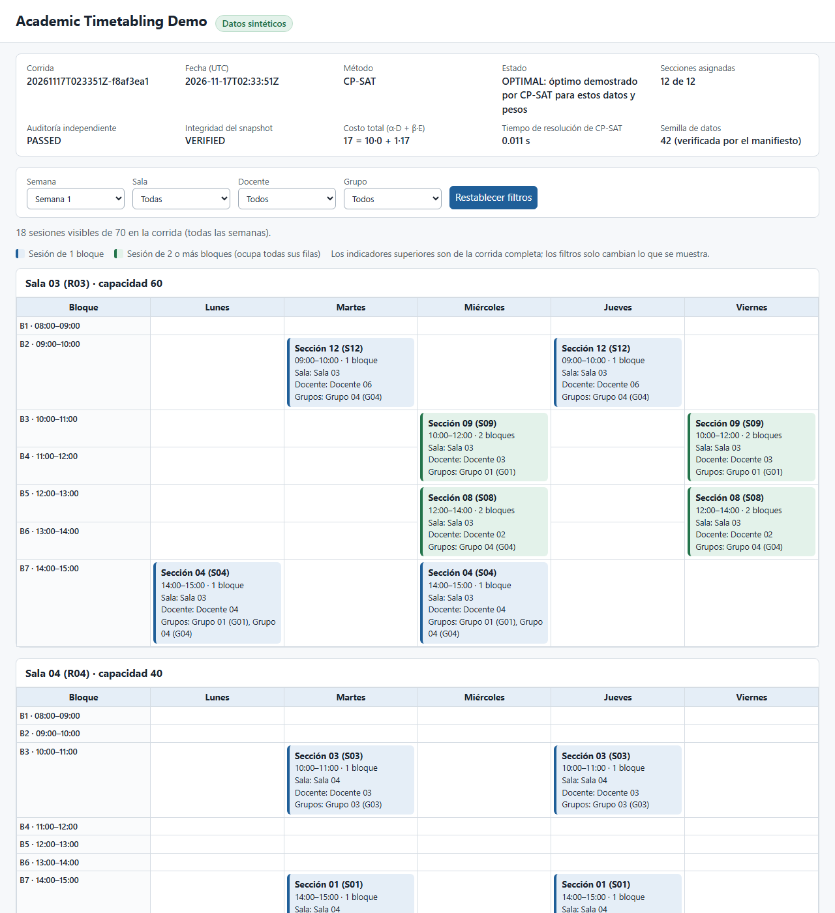

# Conjunto de demostración

Corridas reales generadas desde el commit `25fae94` con el árbol de trabajo limpio, sobre el caso sintético `data/synthetic/demo`: 12 secciones, 6 salas, 4 semanas, 5 días y 7 bloques, con semilla de datos 42. Los números de abajo son observaciones de estas corridas, no promesas de rendimiento.



`preview.png` es una captura real de `cpsat/schedule.html`, abierta por `file://` en Microsoft Edge 157 sin interfaz, a 1280 × 1400 px, en la semana 1 y sin filtros.

## Contenido

| Ruta | Qué es | Resultado |
|---|---|---|
| `cpsat/` | `run --solver cp-sat --time-limit 30 --seed 42` | Código 0, OPTIMAL, objetivo 17 (D=0, E=17), cota 17, auditoría PASSED, integridad VERIFIED |
| `greedy/` | `run --solver greedy` sobre la misma entrada y los mismos pesos | Código 0, COMPLETE, objetivo 21 (D=0, E=21), auditoría PASSED |
| `comparison.json` | `compare --runs docs/demo/greedy docs/demo/cpsat` | COMPARED: diferencia 4 (21 − 17), 19.05 % sobre la heurística, a favor de CP-SAT |
| `changed/` | `scripts/demo_change.py --base-run docs/demo/cpsat` | Ver «Cambio de disponibilidad» |

Cada corrida contiene:

- `input/`: snapshot de las 21 fuentes.
- `effective_config.json`.
- `metrics.json`: estados, hashes, versiones, tiempos y procedencia.
- `diagnostics.json`.
- `audit.json`.
- `assignments.csv`.
- `schedule.csv`: 70 filas, una por sesión y semana activa.
- `schedule.html`.

Las dos corridas de la demo comparten el hash global de entrada `2fd989b234c13f9fbab50ba18ee18d9a782a0782b676b954c18745721e5d27c2`, y su procedencia es `VERIFIED` con semilla de datos 42.

## Cambio de disponibilidad

El script elige de forma estable la primera sección asignada (S01), su primera semana activa (1), su primera sesión (día 2, bloque 7) y su docente (T01). Luego retira solo la fila `T01,1,2,7` de `teacher_available.csv`. Las otras 20 fuentes se copian sin cambios a `changed/changed-input/`, y `generation.json` no se copia: la procedencia de la nueva corrida es `ABSENT`, no `VERIFIED`.

`changed/changed-run/` es la nueva corrida CP-SAT, con la misma configuración efectiva que la base (hash `26a3b784…`). Terminó con código 0, OPTIMAL, objetivo 17 y auditoría PASSED. `changed/change.json` registra el cambio exacto y el recuento de reasignaciones por sección:

| Categoría | Secciones |
|---|---|
| Sin cambios | 7 |
| Cambio de patrón | 4: S04, S07, S09, S10 |
| Cambio de sala | 0 |
| Cambio de patrón y sala | 1: S01, de P2X1-D24-B7/R04 a P2X1-D13-B7/R02 |

Es un recuento de reasignaciones entre entradas distintas, no una comparación de calidad. CP-SAT no minimiza cambios, así que otras secciones pueden moverse aunque no haga falta. Por eso `compare` rechaza la corrida modificada frente a las de la base, con código 2 por entradas distintas.

## Guion de cinco minutos

1. **Datos y supuestos (1 min).** Abrir `cpsat/input/` o `data/synthetic/demo/`. Todo es sintético; cada sección tiene docente, grupos, semanas activas y patrones autorizados. La disponibilidad ausente significa no disponible, y las reservas y franjas protegidas son reglas duras.
2. **Ejecución y grilla (1 min).** Abrir `cpsat/schedule.html` con doble clic. Mostrar los indicadores (OPTIMAL, 12 de 12, costo 17 = 10·0 + 1·17), cambiar de semana y filtrar por sala, docente y grupo. Las sesiones dobles ocupan dos bloques y «Restablecer filtros» vuelve al inicio.
3. **Auditoría (1 min).** Ejecutar el comando `audit` de la sección siguiente. El auditor reconstruye todo desde las fuentes, sin candidatos ni solver.
4. **Comparación con la heurística (1 min).** Abrir `greedy/schedule.html` y `comparison.json`. La heurística completa el horario con costo 21 y CP-SAT con 17. Es una observación de este caso, no una superioridad general.
5. **Cambio de disponibilidad (1 min).** Abrir `changed/change.json`: se retiró T01 en la semana 1, día 2, bloque 7. La nueva corrida sigue en OPTIMAL y auditada, con 5 secciones reasignadas. Abrir `changed/changed-run/schedule.html`.

El navegador solo filtra datos ya calculados; las soluciones nuevas se calculan en Python.

## Regenerar y verificar desde un clon

```bash
uv sync --locked
uv run python -m academic_timetabling_demo audit --input docs/demo/cpsat/input --assignments docs/demo/cpsat/assignments.csv --config docs/demo/cpsat/effective_config.json --reported-objective 17
uv run python -m academic_timetabling_demo compare --runs docs/demo/greedy docs/demo/cpsat --out runs/comparison-check.json
```

Para regenerar un conjunto equivalente en otra carpeta (`run` y `compare` se niegan a escribir en salidas que ya existen):

```bash
uv run python -m academic_timetabling_demo run --input data/synthetic/demo --solver cp-sat --time-limit 30 --seed 42 --out runs/demo-cpsat
uv run python -m academic_timetabling_demo run --input data/synthetic/demo --solver greedy --out runs/demo-greedy
uv run python -m academic_timetabling_demo compare --runs runs/demo-greedy runs/demo-cpsat --out runs/comparison.json
uv run python scripts/demo_change.py --base-run runs/demo-cpsat --out runs/demo-change
```

Los `run_id`, las fechas y los tiempos cambian en cada ejecución. Los hashes de entrada, los objetivos y las asignaciones de este caso fueron estables en las ejecuciones observadas con un trabajador.

## Límites

- **Tiempos:** son de una sola ejecución en Windows 11 con Python 3.12.16, OR-Tools 9.15.6755 y SQLite 3.53.1. CP-SAT tardó unos 0.01 s en resolver, y la corrida completa con exportación unos 0.4 s.
- **Escala:** un solo dataset pequeño. No se prometen resultados de 16 semanas ni de casos mayores.
- **Bytes exactos:** los hashes de cada corrida son de bytes exactos. La regla `docs/demo/** -text` impide conversiones de Git en este conjunto, incluidos los clones con `core.autocrlf=true`. La revisión comprobó auditorías, comparaciones y hashes desde clones con ambas políticas de finales de línea.

## Procedencia e historia pública

Las revisiones Git de las métricas identifican la generación original de estas muestras y se conservan sin alterarlas. Esa preparación permanece en la rama local de revisión; el historial público integra una copia final revisada en un solo commit. Para reproducir el flujo, usar los comandos de este documento desde la versión pública actual. No se promete que coincidan run_id, fechas o tiempos.
